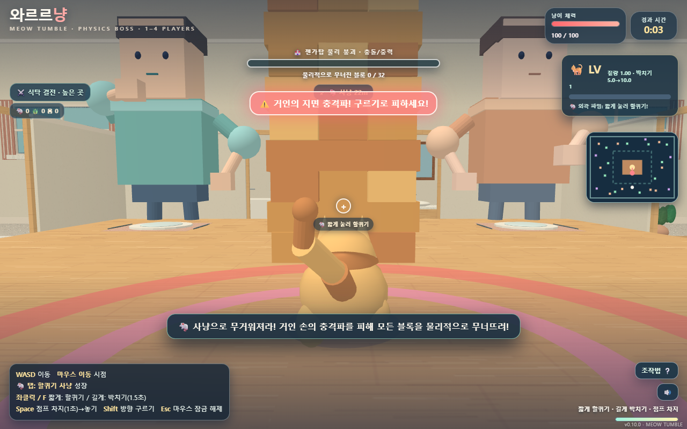

# 와르르냥 / Meow Tumble

집 안을 누비는 작은 고양이가 쥐·곤충을 사냥하며 성장하고, 사람의 공격을 피하며 거대한 젠가탑을 무너뜨리는 **Rapier 3D 물리 게임**입니다. 블록이 무너지는 마지막 순간까지 관전하세요.

**[▶ 바로 플레이 / Play now](https://byh-playground.github.io/meow-tumble/)** · **v0.17.2** · PC / 터치 · 1–4명

A small cat hunts around a house, grows heavier, dodges people, and topples a tower through real rigid-body physics. Watch the collapse unfold before the result screen.

## 조작

| 행동 | PC | 터치 |
| --- | --- | --- |
| 이동 / 시점 | WASD·방향키 / 마우스 이동 | 왼쪽 스틱 / 오른쪽 드래그 |
| 할퀴기 / 박치기 | F·좌클릭 짧게 / 길게 누른 뒤 놓기 | 발바닥 버튼 탭 / 홀드 |
| 점프 / 구르기 | Space 홀드 후 놓기 / Shift (지상·공중) | 점프 홀드 / 구르기 버튼 (지상·공중) |

시작하기 → 혼자 시작, 또는 친구와 함께 → 방 만들기·4자리 코드 참가 → 방장이 시작합니다. 도움말·설정은 별도 화면이며, 플레이 중 지도·상세 버튼으로 추가 HUD를 확인합니다. 결과 화면에서는 방장이 다시 시작하거나 각자 타이틀로 돌아갈 수 있습니다. 최고 레벨은 12이며 도달하면 MAX로 표시합니다. HP가 0이면 현재 레벨 구간 XP의 10%를 잃고 경계를 넘으면 레벨이 내려갑니다 (최저 1). 만렙에서는 11→12 구간을 기준으로 차감하고 초과 XP는 쌓이지 않습니다. 탑 진행도는 유지하며 부활합니다. Esc로 마우스 잠금을 해제합니다.

## 실행과 구성

`index.html` 하나가 현행 소스이자 배포 파일입니다. 빌드가 없습니다. 저장소에서 `python -m http.server 8080`을 실행한 뒤 http://localhost:8080 에 접속합니다. WebGL 및 외부 GameKit·Rapier CDN 접속이 필요합니다. 멀티플레이에는 공개 Nostr relay와 WebRTC 연결이 필요합니다.

GameKit **v0.3.2**, dist `280e86650abec73cb9333379999a6bcadbb9234d`에 고정합니다. 입력·루프·PRNG·방/세션·보간·확정 표시 이벤트를 SDK가 맡고, 호스트의 Rapier 월드가 싱글/멀티의 같은 게임 규칙을 실행합니다. 게스트 보간은 표시 전용이며 별도 이동 시뮬레이션을 만들지 않습니다. 의존성 해시는 [dependencies.json](docs/dependencies.json)에 있습니다.

## 검증과 배포

Windows Edge와 실제 Rapier·GameKit, 서로 분리된 두 브라우저의 실제 Nostr/WebRTC 연결로 대표 흐름을 확인합니다. 이동·양쪽 경사로·구르기·방 참가·멀티 이동·재시작이 검증 대상입니다. HP 0와 붕괴는 실제 엔진을 사용하는 통제된 상태 경계 시나리오도 별도로 확인합니다. 상세 결과와 한계는 [이관 PR #1](https://github.com/byh-playground/meow-tumble/pull/1)에 기록했습니다. 외부 NAT 간 연결, 4인, 모바일 실기기, 장시간 밸런스는 미검증입니다.

Actions는 PR에서 배포 파일을 준비하고, main 병합 후 Pages에 같은 HTML을 배포합니다. 회귀 스크립트는 임시 검증 환경에서 실행하고 저장소에 남기지 않습니다.

## 출처와 관리

원본 `do_meow_no_house_raid_v0_9_3.html`의 크기·SHA-256·출처·최초 커밋은 [origin.json](docs/origin.json)에 보존합니다. 원본 코드는 최초 커밋에서 볼 수 있으며 실행 복사본을 중복 유지하지 않습니다. 원본의 절차적 집·고양이 렌더, Rapier 물리, 조작과 붕괴 관전을 유지했습니다.

0.10.0은 원격 동작·전투 이벤트 패킷 변경으로 이전 방과 호환되지 않는 MINOR 변경입니다. 전역/캐릭터 부활 타이머 중복, 원격 HP 차이로 타격을 추정하던 경로, 별도 게스트 이동 예측, 재시작 시 물리 큐 누수를 정리했습니다.

[개발 규칙](https://github.com/byh-playground/bloom-reference/blob/main/rules/development.html) · [관리 규칙](https://github.com/byh-playground/bloom-reference/blob/main/rules/project-management.html) · [UI/UX 규칙](https://github.com/byh-playground/bloom-reference/blob/main/rules/visual-ux.html)

이 저장소에 새 프로젝트 라이선스를 임의로 부여하지 않았습니다. 외부 [Rapier 0.21.0](https://github.com/dimforge/rapier.js) 및 [Bloom GameKit](https://github.com/byh-playground/bloom-gamekit)의 기존 권리·고지를 유지합니다. 집·고양이·효과는 원본의 절차적 그래픽이며 별도 이미지 에셋으로 교체하지 않았습니다.

## GameKit 0.3.1 후보 검증

0.10.1은 SDK 배포 pin과 공식 모듈 해시만 갱신한 호환 PATCH입니다. 게임 규칙·30TPS·기존 방 namespace를 유지합니다. [현재 로컬 결과](docs/verification-sdk031.json)는 Chromium 시작 단계의 실행 환경 차단이며 게임 PASS가 아닙니다. 기존 Edge 검증은 위에 별도 역사 기록으로 유지합니다. 사용자 요청에 따라 이번 호환 PATCH는 정적 코드·빌드 검증으로 배포하며, 실제 브라우저 재검증은 추후 사용자 확인으로 남깁니다.

## 메뉴 정리 0.10.2 (후보)

타이틀·모드 선택·대기실·도움말·설정을 GameKit navigation의 hash 화면으로 분리합니다. 주소 진입과 이력 복원은 게임 시작·방 종료를 실행하지 않습니다. 플레이 중 도움말·설정은 입력만 차단하며 세계는 계속 움직입니다. 기존 게임 규칙·네트워크 계약은 유지하는 호환 PATCH입니다. 실제 브라우저 검증 및 배포 상태는 해당 PR에 기록합니다.

## 성장 확장 0.10.3

1–8 레벨의 XP 문턱과 위력을 보존하고 최고 레벨을 12로 확장합니다. 새 누적 XP 문턱은 47/58/70/83이며 질량은 레벨당 ×1.5, 박치기 기본속도는 +5/7씩 기존 추세를 연장합니다. 사망 XP 손실은 소수 첫째 자리까지 적용되며 호스트의 한 번의 사망 전이에서만 차감합니다. 스냅샷 형식은 유지합니다. 실제 브라우저 검증과 배포 상태는 해당 PR에서 확인합니다.

고양이 외형·충돌 반지름은 기존 기본 크기 대비 LV1 60%에서 LV12 120%까지 선형 성장합니다. 레벨 하락도 같은 크기·질량 경로를 사용하며 발 위치를 유지합니다. 할퀴기 판정·그림자·전신 회전·이름표·카메라 주시 높이도 크기를 따릅니다.

## 로봇청소기 장애물 0.11.0

서쪽·동쪽 사냥 통로에 낮고 둥근 로봇청소기가 한 대씩 순찰합니다. 불빛·경고음과 바닥 방향 표시를 보고 옆으로 피하거나 구르세요. 1초 예고 뒤 방향을 바꾸지 않고 짧게 돌진하며, 실제 충돌 충격량에 비례한 피해와 Rapier가 계산한 밀침을 받습니다. 벽에 부딪히면 2.4초 멈추므로 그 틈에 사냥할 수 있습니다. 청소기는 XP를 빼앗거나 사냥 보상을 바꾸지 않습니다. 시작 직후 5초와 부활 무적 중에는 대상을 잡지 않으며 시작 구역을 보호합니다.

순찰·돌진 능력이 전용 상태와 설정을 소유하고 기존 Rapier 접촉·공통 HP 경로를 사용합니다. 호스트만 물리를 실행하며 게스트는 GameKit 보간과 확정 표시 이벤트로 청소기·경고음을 표시합니다. 새 청소기 스냅샷은 기존 방과 호환되지 않으므로 MINOR 0.11.0 및 전용 방 namespace를 사용합니다. GameKit·Rapier 의존성 및 기존 배포 경로는 유지합니다. 실제 브라우저 검증과 배포 상태는 해당 PR에서 확인합니다.

## 이동 표시와 벽 카메라 0.11.1

카메라·고양이·먹이·로봇청소기·월드 체력바가 GameKit PresentationRuntime의 같은 표시 프레임을 읽습니다. 싱글/호스트는 완료된 30 TPS 물리 표본과 공식 loop alpha를, 게스트는 수신한 표본을 사용합니다. 표시 좌표는 물리·HP·입력에 되쓰지 않으며 부활·재시작은 이전 경로와 연결하지 않습니다. 기존 게스트 전용 보간과 원본 좌표 fallback은 제거했습니다. 공식 loop가 긴 프레임 공백의 누적 시간이나 숨김 상태의 타이밍을 버릴 때에는 로컬 표시 구간도 현재 권위 표본으로 재설정합니다. 게스트 수신 시계와 일반 프레임의 보간 연속성은 유지합니다.

벽 카메라는 사용자가 정한 방향과 어깨 기준점을 유지합니다. Rapier 구체 스윕으로 반경과 여유를 포함한 안전거리를 구하고 GameKit camera의 CollisionBoom이 즉시 안쪽으로 줄인 뒤 잠시 유지하고 시간 기준으로 복원합니다. 옆·위쪽 후보로 카메라를 자동 전환하거나 최소 보기 거리를 이유로 벽을 통과하지 않습니다. 피격 흔들림의 최종 위치도 충돌을 다시 검사합니다.

설계 근거: [Unity Deoccluder의 Pull Camera Forward·Smoothing Time](https://docs.unity3d.com/Packages/com.unity.cinemachine@3.1/manual/CinemachineDeoccluder.html), [Third Person Follow 충돌 감쇠](https://docs.unity3d.com/Packages/com.unity.cinemachine@3.1/manual/CinemachineThirdPersonFollow.html), [Unreal SpringArm의 구체 충돌 검사](https://dev.epicgames.com/documentation/en-us/unreal-engine/API/Runtime/Engine/USpringArmComponent), [Rapier 장면 쿼리](https://rapier.rs/docs/user_guides/javascript/scene_queries/). 실제 검증 범위·미검증 조건·배포 상태는 해당 PR에 기록합니다.

## 몹 모델과 조작 연계 0.12.0

쥐의 코·귀·눈·수염·마디 꼬리, 딱정벌레의 두 날개껍질·촉수·여섯 다리, 거미의 배·머리·여덟 관절 다리를 기존 절차적 메시로 구별합니다. 발과 꼬리는 같은 표시 프레임의 이동 속도·방향을 따르며 멀리 있는 몹은 세부 묘사를 줄입니다. 사람의 얼굴·옷과 둥근 청소기의 범퍼·센서·상판도 다듬었습니다. 충돌 반지름·HP·보상·기존 카메라와 고양이의 기본 외형은 유지합니다.

점프·낙하 중에도 기존 구르기를 사용합니다. 지상·공중이 1.35초 쿨다운과 650ms 행동·기존 무적 구간을 공유하며, 공중 구르기는 수직 속도에 충격을 주지 않습니다. 피격 행동불능은 유지합니다. 전신 회전 동안 귀·팔다리·꼬리가 말렸다가 펴지고 착지 후 180ms 동안 자세를 정리합니다. 모두 호스트의 같은 상태 전이와 게스트 표시 모델을 사용합니다.

GameKit ActionState의 press/release 보존 위에 게임이 소유하는 짧은 유예를 적용합니다: 점프 150ms, 발판을 벗어난 점프 유예 100ms, 구르기 쿨다운 경계 150ms, 발톱 쿨다운 경계 120ms. 점프 홀드 차징과 최고 초기 속도 20은 그대로이며 한 요청은 한 번만 실행합니다. 일찍 누른 요청이 만료되면 나중 착지·쿨다운 완료에서 실행하지 않습니다. 사망·재시작·메뉴·취소·긴 타이밍 공백에서 요청을 정리합니다. 터치 capture 실패 시에도 화면 밖 해제가 수집되며 취소는 공격/점프 release로 취급하지 않습니다.

멀티 입력의 남은 bit에 명시적 취소 edge를 추가해 게스트의 메뉴·입력 취소가 호스트 예약까지 비웁니다. 기존 입력/스냅샷 크기는 유지하지만 새 취소 계약 때문에 방 namespace와 제품 MINOR를 0.12.0으로 분리합니다. 구버전 방과 섞이지 않습니다. SDK·Rapier pin과 기존 main→Pages 배포는 유지합니다.

설계 참고: [BLOOM 시각 UX의 입력·예고·실행·회복 및 취소 계약](https://github.com/byh-playground/bloom-reference/blob/main/rules/visual-ux.html), [GameKit 입력 소유권](https://github.com/byh-playground/bloom-gamekit/blob/main/modules/input/README.md), [Celeste 개발자 공개 코드의 점프 유예](https://github.com/NoelFB/Celeste/blob/master/Source/Player/Player.cs). 외부 모델/이미지/코드를 복사하지 않았습니다. 실제 Edge PC·390px·RTC 검증 결과와 한계는 해당 PR에 기록합니다.

## 모바일 가로 플레이 0.12.1

터치 기기는 가로 화면 기준으로 HUD와 104px 이동 스틱, 64px 점프·60px 구르기·92px 공격 버튼을 배치합니다. 화면 안전 영역을 피하고 상세 HUD는 중앙의 스크롤 패널에서 확인합니다. 세로 진입에는 회전 안내를 제공하며 진행 중 회전에서는 눌린 입력과 입력 버퍼만 취소합니다. 본게임·멀티 시뮬레이션, 방 연결과 카메라 방향은 유지합니다. 캔버스를 CSS로 회전하지 않고 실제 뷰포트 비율로 투영합니다.

방향 잠금은 지원 브라우저에서 사용자가 가로 전환 버튼을 누를 때 전체 화면과 함께 시도합니다. API가 없거나 거절되면 수동 회전 안내를 유지합니다. 모든 모바일 브라우저의 강제 회전을 보장하지 않습니다. 네트워크·저장 계약은 그대로인 호환 PATCH이며 0.12.0 방 namespace와 SDK·Rapier pin을 유지합니다. 실제 Edge 가로·세로 전환, 작은 가로, PC 및 RTC 검증 결과는 해당 PR에 기록합니다. 물리 모바일 기기의 센서·노치·브라우저 검증은 별도이며 데스크톱 터치 에뮬레이션과 구분합니다.

## Hold 차지·모바일 조준·사람 투척 0.13.0

차지 버튼과 점프의 실제 held 명령을 매 틱 확인합니다. 피격·날아감·구르기·회복 중 계속 누르면 시작 가능한 첫 틱에 차지를 시작하며, 공격 쿨다운에서는 차지를 기다리되 짧은 할퀴기는 유지합니다. 실제 release에서만 발사하고 cancel·blur·화면 회전·사망에서는 발사하지 않고 의도를 해제합니다. 모바일 공격 버튼을 누른 손가락으로 드래그하면 기존 시점 감도와 같은 조준을 합니다. 처음 6px 떨림은 무시하며 버튼 밖에서도 충전을 유지합니다. 왼손 이동과 오른손 충전+조준을 함께 사용할 수 있습니다.

사람 모델은 0.15.0에서 축소 전 0.12.1 커밋 d82b22485b79407006b7c57749a3d6b1d587c1fb의 배율 3.10·높이 12.1675·z=-8.6·라벨 y=12.25로 복원했습니다. 해당 원본에는 사람 신체 강체가 없었으므로 축소 때 추가한 캡슐도 제거했습니다. 카메라로 크기를 숨기지 않습니다. A는 초록 옷의 근접 손바닥/쓸기, B는 주황 옷과 색깔 장난감 공의 투척 성향입니다. 투척 조준은 1.5초 준비 중 추적하다 마지막 450ms에 고정되고 준비 동작 후 발사합니다. 탑에서 블록을 가져오지 않는 별도 장난감 공을 던지므로 탑을 공짜로 해체하지 않습니다.

대표 비교는 LV4 풀차지 고양이: 질량 3.375, 속도 14.286, 발사 운동량 48.214입니다. 투척 질량 2, 발사 속도 20, 발사 운동량 40으로 설정했고 실제 접촉 충격량을 Rapier contact manifold에서 측정합니다. CCD 강체의 접촉만 충격을 전달하고 별도 임펄스를 중복 적용하지 않습니다. 0.15.0의 공은 접촉 뒤에도 남아 굴러다니고 잠들 수 있는 자유 회전 동적 구체입니다. TTL·접촉 소비·추가 접촉 임펄스는 없습니다. 이미 불안정한 탑의 후속 물리 붕괴도 차단하지 않습니다.

새 투사체 상태와 인간 패턴이 기존 버전과 함께 실행될 수 없어 MINOR 0.13.0 namespace로 분리합니다. SDK·Rapier pin 및 기존 Pages 배포는 유지합니다. 대표 PC/모바일·2인 RTC·충격량 검증과 실제 측정값은 PR에 기록합니다. 물리 모바일 및 iOS Safari는 별도 미검증 범위입니다.

대표 Edge 측정: LV4 풀차지 대시의 누적 Rapier 블록 접촉 충격량은 91.10(대시 구동 유지 포함), 단발 투척은 표적 높이 0.35/3.5/7에서 34.83/33.68/23.78이었습니다. 세 정상 탑 시나리오 모두 단발 후 흩어진 블록 0, 게임 계속 진행이었고, 이미 지지대가 불안정한 별도 시나리오는 실제 물리 붕괴가 계속됐습니다. 이는 한정된 대표 배치의 측정값이며 모든 각도·무게·불안정 상태의 보편 상한을 의미하지 않습니다.

## 투척물 정정 0.14.0

탑의 일반 젠가는 질량 20, 크기 1.07×0.70×3.48입니다. 질량 2인 투척물을 같은 젠가 외형으로 표현한 부분을 정정했습니다. 사람 B는 분홍·크림·민트색 장난감 공을 들고 던집니다. 공은 반경 0.45의 구형 Rapier 충돌체이며 질량 2·발사 속도 20·운동량 40, 기존 조준 추적→450ms 방향 고정→발사·첫 접촉 소비 흐름을 유지합니다. 탑의 일반 젠가 질량·크기·물리는 변경하지 않았습니다. 이전 버전은 직육면체 투척물로 표시/충돌하므로 서로 섞이지 않게 0.14.0 방 namespace로 분리합니다. 패킷 형식과 SDK·Rapier pin은 그대로입니다. 이전 단발 측정치는 0.13.0 직육면체에 대한 기록이며 새 공의 대표 접촉 측정은 해당 PR에 기록합니다.

## 사람 복원·지속 물리 공·쌓기 표현 0.15.0

크기를 줄이라는 요청이 아니었으므로 인간은 축소 직전 실제 코드로 복원했습니다. 모델 배율 3.10, 계산 높이 12.1675, 위치 x=±8.4/z=-8.6, 그림자 반경 2.25, 손 최대 사거리 1.65×3.10, 라벨 y=12.25입니다. 근접 표적 선택과 조준 범위도 원본의 전투 영역/클램프 기준으로 복원합니다. 잘못된 사람 명칭은 HUD·도움말·피격 안내·진단 필드까지 사람으로 정리합니다.

공은 질량 2·반경 0.45·발사 속도 20·운동량 40을 유지하는 CCD 동적 구체입니다. 마찰 0.55, 반발 0.15, 선형/각 감쇠 0.16/0.5를 적용하며 회전을 잠그지 않습니다. 공을 접촉 직후나 TTL로 삭제하지 않습니다. 굴림·바닥/고양이/젠가/다른 공 접촉과 sleep/wake는 Rapier가 결정합니다. 충돌 후 고양이의 실제 속도 변화에 맞춰 200ms 제어 유예와 피격 상태를 적용하며 접촉 임펄스를 더하지 않습니다. 기존 삭제 경로 때문에 바닥을 먼저 맞고 사라지던 공도 이제 남아 재접촉합니다. 원래 사람의 키 복원으로 위치 에너지가 커지지 않도록 투척은 기존 승인된 월드 높이(floor+3.77)의 손밑 던지기 앵커를 유지합니다.

라운드당 공은 최대 24개입니다. 상한에서 새 공을 던질 때 생성 순서상 가장 오래된 공 하나를 제거하고 새 공을 생성합니다. 같은 생성 tick이면 entity ID가 작은 공부터 교체하며, 호스트가 선택한 결과를 게스트가 그대로 표시합니다. 제거 시 물리 body/collider, 접촉 기록과 렌더 참조를 함께 정리합니다. 상한 미만에서는 시간 경과나 첫 충돌로 공을 삭제하지 않습니다. 상세 HUD에 공 개수, 사람 B 라벨에 오래된 공 교체를 표시합니다. 한 판 더에서 새 월드와 함께 초기화합니다. 이후 중력·마찰·반발이 만드는 접촉은 순수 물리이므로 발사 운동량 40은 평생 접촉 충격량 합의 상한을 뜻하지 않습니다.

쌓기는 한 사람이 다음 슬롯을 예약하고 집기→들기→운반→정렬→내려놓기→손떼기를 같은 자재 pose에서 표현합니다. 원래 신체를 늘리지 않고 손 사거리 밖은 보이는 집게로 연결합니다. 자재/집게는 표시 소품이며, 내려놓는 순간 같은 pose에서 기존 질량 20 Rapier 동적 블록 생성으로 인계합니다. 이미 존재하는 탑 블록을 이동/고정하지 않습니다. 공 quaternion/sleep 상태와 쌓기 계획을 호스트가 보내며 게스트는 물리를 중복 실행하지 않습니다. 새 상태 계약으로 0.15.0 namespace/protocol6을 사용합니다. 기존 hold 자동 차지·모바일 차지 드래그·질량 20 젠가·SDK/Rapier pin과 Pages 경로는 유지합니다.

## 공통 충격량 피해 0.15.1 (0.15.2에서 공격원 방향성 보완)

공 접촉 고정 16 HP, 사람 27/19 HP, 청소기 5 HP 및 박치기의 전체 상대속도/예약속도 피해를 제거했습니다. 고양이·먹이의 체력은 공·젠가·다른 고양이·먹이·청소기와의 실제 강체 접촉에서 같은 계산을 사용합니다. 젠가와 공에는 별도 가상 HP를 추가하지 않습니다. 바닥·가구의 이동/지지 접촉은 기존 이동 물리이며 새로운 낙하/벽 충돌 피해를 추가하지 않습니다. 질량은 공 2, 젠가 20 및 기존 성장식을 유지합니다.

Rapier 0.21.0의 contactImpulse는 법선 방향 충격량이며 단위는 게임 질량단위×거리단위/초입니다. SI 스케일을 별도로 지정한 게임은 아닙니다. force가 아니므로 dt를 곱하지 않습니다. 마찰 접선 충격량은 HP 계산에서 제외합니다. 각 60 Hz substep 직전 강체 선형/각속도를 보존하고, 접점의 법선 접근속도(v + ω×r)를 계산합니다. flipped manifold 방향과 회전 전후 접점 앵커를 반영합니다. 법선 접근속도 2 이상인 접점의 실제 법선 충격 벡터를 collider 쌍별로 합산한 크기가 J입니다. 지지력·단순 겹침·느린 굴림은 접근속도 조건을 통과하지 않습니다. 엔진이 회전 관성·유효 질량을 반영해 푼 J를 사용하며, 물체 전체 속도로 충격량을 추정하지 않습니다.

공통 공식은 J≥1, 대상 Δv=J/m>1일 때 min(60,ceil((Δv−1)×1.4)) HP입니다. 접근속도 조건은 실제 물리 접촉에 적용합니다. 별도 사람 강체가 없는 충격파와 할퀴기는 Rapier applyImpulse 전후 실제 선형 운동량 변화 m×|v후−v전|을 같은 피해 공식에 전달합니다. 접촉에 추가 넉백 임펄스를 더하지 않으며, 실제 solver 속도에 200ms 조향 유예와 강한 충격 피격 자세를 연결합니다.

한 collider 쌍의 접촉 구간은 한 번만 처리합니다. 여러 접점·manifold·60Hz substep·중복 이벤트는 별도 피해가 아닙니다. 두 물체가 분리되면 재충돌은 새 구간입니다. 독립 물리 충돌을 기존 피격 깜빡임 타이머로 차단하지 않으며 부활 보호 2200ms와 구르기 회피는 유지합니다. 한 번의 사람 휩쓸기에서 생긴 여러 파동도 대상 집합을 공유합니다. 공 FIFO 제거는 접촉 구간 기록까지 정리합니다.

체력·XP·피격 소유자는 기존 호스트 물리 시뮬레이션 하나입니다. 게스트는 확정 HP/동작/이벤트만 표시하며 물리 예측/롤백을 실행하지 않습니다. 같은 스냅샷 반복 수신이 피해를 다시 실행하지 않습니다. 0.15.1 방 namespace를 사용하며 패킷 protocol6과 SDK/Rapier pin, 기존 Pages Actions 배포를 유지합니다.

대표 실제 Edge 155 검증: 느린 실제 접촉/정지 공 및 질량20 젠가 지지력은 무피해, 강한 충격은 점진 피해·실제 변위, 분리 후 같은 공 재충돌, 동일 solver 재조회, 회전 젠가 접점 속도, 고양이끼리/청소기/사람/할퀴기 공통 경로, 질량2 공 25번째 FIFO, 실제 2인 게스트만 피해/표시 일치/중복 스냅샷 무피해를 확인했습니다. 무중력 질량1·2 정면충돌은 J=10.23999977로 m_eff×(1+e)×v_n=10.24와 일치했습니다. 검증 일부는 위치/속도 준비와 수동 고정 tick을 사용했고, 별도로 실제 실행 중 키 입력·2인 RTC를 확인했습니다. 실물 모바일·iOS Safari·4인/외부 NAT는 미검증입니다.

## 공격원 방향성 피해 0.15.2

수용 기준은 빠른 고양이가 정지/느린 공에 부딪혀도 고양이 피해는 0이고, 고양이에게 접근하는 공의 공격 강도에 따라 고양이 피해가 발생하는 것입니다. 물리 반작용은 그대로이며, 같은 접촉 충격량을 양쪽 체력 피해로 복사하지 않습니다. 공 전용 예외 없이 젠가·청소기·고양이·먹이에도 같은 공격원 규칙을 적용합니다.

공식 자료 대조: [Rapier contact graph](https://rapier.rs/docs/user_guides/javascript/advanced_collision_detection/)에서 broad-phase 후보와 실제 접촉, 법선/solver contact와 collider 순서를 구분하며, [Rapier ContactData 소스](https://github.com/dimforge/rapier/blob/master/src/geometry/contact_pair.rs)는 두 강체의 반대 방향 물리 충격량을 설명합니다. [Epic Damage in UE4](https://www.unrealengine.com/blog/damage-in-ue4?lang=en-US)는 공격원/피격 사건/피해 처리 모델을 게임별 규칙으로 구분합니다. 이 문서들이 아래 수식을 표준으로 지정한 것은 아닙니다. 엔진의 물리 응답과 게임 피해 소유권을 분리한 이번 게임의 선택입니다. 고정된 Rapier 0.21.0의 선언과 실제 엔진 비교도 함께 확인했습니다.

각 실제 접점에서 공격원→대상 법선을 n, 충돌 직전 접점 속도를 v공격/v대상이라 할 때 s=max(0,v공격·n), c=max(0,(v공격−v대상)·n), u=min(s,c)입니다. c≥2와 u≥2인 접점의 solver 법선 충격 벡터를 u/c 비율로 배분하고 합산한 크기가 방향별 J공격입니다. 기존 피해 곡선 min(60,ceil(max(0,J공격/m−1)×1.4))과 J공격≥1 조건은 유지합니다. 단위는 게임 질량단위×거리단위/초이며 마찰·렌더 속도·월드 총속도 크기를 피해로 쓰지 않습니다.

대상만 공격원 쪽으로 달려오면 s=0이므로 받는 공격 피해는 0입니다. 양쪽이 접근해 커진 상대속도는 공격원 자신의 속도 몫으로 제한합니다. 같은 방향 추격에서는 실제 속도 차이 c로 전달 강도가 줄고, 대상이 더 빨라 접촉하지 않으면 판정 자체가 없습니다. 첫 실제 접촉에서 양쪽 기여를 충돌 전 속도로 확정합니다. 정지 겹침의 0 충격량 접촉도 구간을 소비하므로 같은 접촉에서 반작용으로 얻은 속도를 역공으로 읽지 않습니다. 단순 broad-phase/아직 닿지 않은 예측 후보로는 공격 기회를 소비하지 않으며 분리 후 재충돌은 새 구간입니다.

사람 파동·할퀴기는 의도적으로 적용한 Rapier 임펄스를 명시적 human/cat 공격원으로 전달하며 대상의 기존 이동 속도를 공격 강도에 더하지 않습니다. 체력·피격 자세·표시와 2인 권위 구조, 부활/구르기 보호, 공2·젠가20 질량과 FIFO는 유지합니다. 방 namespace는 0.15.2이며 protocol6/SDK/Rapier pin/기존 Pages 경로는 유지합니다.

대표 실제 Edge 비교: 무중력/무감쇠 분리 fixture에서 고양이 속도12→정지 공은 원래 13 HP에서 0으로 수정됐고, 물리 J10.23999977과 두 강체의 충돌 후 속도/위치는 0.15.1과 정확히 같았습니다. 공 속도12→정지 고양이는 전후 동일13 HP입니다. 공 속도6/12의 피해6/13 HP, 양쪽 접근(공12/고양이6)도13 HP, 같은 방향 추격(공12/고양이6)은6 HP, 대상이15로 도망가면 접촉/피해0을 확인했습니다. 기본 중력·마찰·controller의 실제 WASD 고양이→정지 공은0 HP, 날아오는 공은15 HP였습니다. 숫자 차이는 방향별 배분 여부 및 중력/마찰을 분리한 fixture와 실제 지면 상황의 차이입니다. 실제2인도 움직이는 게스트→정지 공0, 공→게스트 피해·양쪽 HP 일치와 게스트 물리0회, 스냅샷 재적용 무피해를 확인했습니다. 위치/속도 준비 및 고정 tick을 사용한 fixture와 실제 실행/키 입력/RTC를 구분합니다. 실물 모바일·iOS·4인/외부 NAT는 미검증입니다.

## v0.16.0: fixed-arm Jenga carrying

The starting tower is now 16 layers (down from 22), and its cap is 17 layers (down from 26). This lowers the starting tower by 4.2 world units and the maximum by 6.3, while leaving one full reachable layer for human stacking. A human keeps the existing model scale, walks around the table and up its existing ramp, grips one real mass-20 Rapier block with a spherical hand joint, carries it near the body, then raises and aligns it with a fixed two-segment arm before releasing it to free physics. Strong impacts can release the grip. No camera snap, extra platform, or ladder is added. The multiplayer namespace/protocol advances to 0.16.0/7 so old snapshot readers do not mix with this scene state.

## v0.17.0: human Jenga stacking and the starting tower

The starting tower now has 8 layers and the cap remains 17. A human keeps the existing 3.10 model scale and fixed two-segment arm, walks from the supply table along the existing route and ramp, and carries the same dynamic mass-20 Rapier block from pickup through release. A target-velocity-aware PD controller applies impulses to the dynamic body while a torque controller keeps its orientation; the body is never directly repositioned or changed to kinematic. Pickup waits for stable hand contact, and the human stops residual walking motion before carrying so the floor-to-table transition happens on the ramp. The block is gradually aligned, lowered, released, and left to settle under Rapier physics; disturbances can move it or break the grip. No camera snap, platform, or ladder is added. Human scale, arm reach, block mass, toy-ball mass/speed, and damage rules are preserved. The multiplayer namespace/protocol advances to 0.17.0/8 for the changed starting world.

## v0.17.1: faster tower-side human Jenga stacking

The initial 8-layer tower, 17-layer cap, human scale (3.10), and fixed two-segment arm remain unchanged. Each human moves to one work point beside the tower, bends down to pick up a nearby real mass-20 dynamic Rapier block, lifts it toward the body, turns toward the tower, and places and releases that same body with a short alignment pause. The former repeated supply-to-tower carry route is removed. The block stays under impulse-driven physics throughout the handoff and can still be disturbed or released by impacts. Placement checks the fixed arm reach before starting; a target outside reach is left unbuilt rather than reached by stretching the arm.

The multiplayer namespace/protocol advances to 0.17.1/9 for the changed human build sequence. Camera, cat movement, block mass, and toy-ball mass and damage rules remain unchanged.

## v0.17.2: physics-driven cat escape from wedged contacts

When a cat keeps a movement, dash, or roll intent but makes almost no progress for 760 ms, short Rapier raycasts look for a clearer horizontal exit or open space overhead. The cat receives one capped impulse, then waits through a cooldown; if every ray is blocked, it gets a small physical retreat impulse opposite the held direction. Recovery only adds impulses to the existing dynamic body. It never relocates the cat, changes contact filters, alters damage, or runs without player intent.

The multiplayer namespace/protocol advances to 0.17.2/10 for the revised host simulation.

